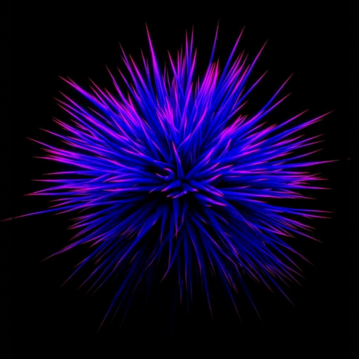

# AMOLED Cyber Glow для TeamSpeak 6

<p align="center">
  
</p>

Красивая тёмная тема для **TeamSpeak 6** с калибровкой под OLED/AMOLED дисплеи, стеклянным эффектом карточек, неоновым свечением микрофона и 12 готовыми цветами на любой вкус.

---

## ✨ Что изменится в вашем TeamSpeak

- 🖤 **Настоящий глубокий чёрный фон:** Пиксели на OLED-экранах полностью отключаются, а глаза не устают при общении в темноте.
- 💊 **Удобные карточки каналов (Apple Glass):** Голосовые каналы разделены аккуратными полупрозрачными плашками и больше не сливаются в один неразборчивый список.
- 🎙️ **Неоновое кольцо голоса:** Вокруг аватарки плавно пульсирует изумрудное кольцо, когда вы говорите в микрофон.
- 🔴 **Наглядные статусы:** Яркое рубиновое свечение, когда микрофон выключен (мут), и янтарное, когда вы отошли.
- 💬 **Красивый чат:** Ваши сообщения подсвечиваются мягким неоном в цвет выбранной темы, блоки кода оформлены под стильный терминал, а интернет-ссылки сразу заметны.
- 🎨 **12 цветовых стилей:** От дерзкого киберпанк-розового до сдержанного титанового и специального режима для обычных IPS-мониторов.

---

## 🎨 12 цветовых вариантов

В тему уже встроены 12 стилей — выбирайте под настроение:

1. **AMOLED Pink** — яркий неоновый розовый в стиле Cyberpunk.
2. **AMOLED Cyan** — морозный электрический циан / неоновый лёд.
3. **AMOLED Purple** — глубокий фиолетовый неон.
4. **AMOLED Amber** — тёплый янтарно-оранжевый.
5. **AMOLED Emerald** — изумрудно-зелёный.
6. **AMOLED Ruby** — насыщенный рубиново-красный.
7. **AMOLED Dark** — стильный тёмный минимализм с фиолетовым акцентом.
8. **AMOLED Silver (Platinum)** — благородный серебристо-платиновый.
9. **AMOLED Abyss (Deep Teal)** — глубокая тёмная морская волна.
10. **Midnight Slate (IPS)** — специальный вариант для обычных IPS/LCD мониторов: глубокий тёмно-серый фон мягко скрадывает засветы матрицы в темноте.
11. **Cyber Graphite** — строгий графитовый оттенок.
12. **Catppuccin Mocha** — уютная кофейно-пастельная палитра.

---

## 🚀 Установка (Windows)

### Способ 1: Автоматически за 5 секунд (Рекомендуется)

1. Нажмите правой кнопкой мыши по кнопке **«Пуск»** и выберите **PowerShell** (или Терминал).
2. Вставьте команду и нажмите **Enter**:

```powershell
irm https://raw.githubusercontent.com/justik13/teamspeak6-amoled-glow/main/update.ps1 | iex
```

Скрипт сам скачает тему и установит её в правильную папку.

---

### Способ 2: Вручную через архив

1. Нажмите зелёную кнопку **Code** вверху этой страницы и выберите **Download ZIP**.
2. Распакуйте архив и переименуйте полученную папку в `amoled.dark.minimalistic`.
3. Переместите эту папку по адресу:
   ```text
   %APPDATA%\TeamSpeak\Default\extensions\amoled.dark.minimalistic
   ```
   *(Чтобы открыть этот путь, нажмите сочетание клавиш **Win + R**, вставьте `%APPDATA%\TeamSpeak\Default\extensions` и нажмите Enter)*.

---

## ⚙️ Как включить тему в TeamSpeak

1. Откройте **TeamSpeak 6**.
2. В левом нижнем углу нажмите **Настройки** (значок шестерёнки) → выберите **«Внешний вид»**.
3. В самом верху в блоке «Стандартная тема» убедитесь, что выбрана **Dark**.
4. Ниже включите тумблер **«Использовать внешнюю тему»**.
5. Кликните по понравившемуся цвету из галереи.
6. ⚠️ **Обязательно полностью перезапустите TeamSpeak:**  
   Нажмите правой кнопкой мыши по иконке TeamSpeak в трее (возле часов Windows) → выберите **«Выход»**, а затем запустите TeamSpeak снова.  
   *(Движок TeamSpeak обновляет оформление только при полном перезапуске программы).*

---

## 🔄 Как обновлять тему

Если вышли новые цвета или улучшения, просто снова запустите команду из **Способа 1** в PowerShell — скрипт автоматически обновит все файлы до последней версии.

---

## 📄 Лицензия

Тема бесплатна и распространяется под лицензией [MIT](LICENSE).
Основана на базе проекта Anthony Dac (Valhalla) с полной переработкой визуала, поддержкой 12 стилей и калибровкой под современные дисплеи.
